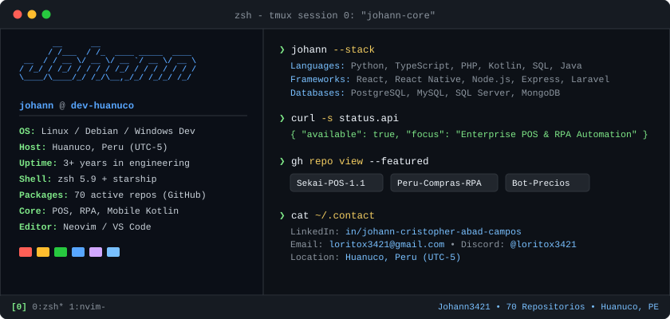

  

 

### 👨‍💻 Sobre Mí

Soy **Johann Cristopher Abad Campos**, desarrollador de software ubicado en **Huánuco, Perú**. Construyo aplicaciones empresariales de extremo a extremo, enfocándome en arquitectura transaccional, automatización de procesos mediante RPA y desarrollo móvil:

* 🏪 **Sistemas Retail & POS:** Arquitectura y desarrollo de soluciones de punto de venta, inventarios críticos y facturación en tiempo real (**Sekai-POS**).
* 🤖 **Automatización & RPA:** Extracción de datos masiva y monitoreo autónomo continuo de licitaciones públicas estatales (**Perú Compras**).
* 📱 **Desarrollo Móvil & Biometría:** Apps nativas en **Android (Kotlin)** con integración de visión computacional y reconocimiento facial en el dispositivo.

---

### 🚀 Repositorios & Proyectos Destacados

<table>
  <thead>
    <tr>
      <th>Proyecto</th>
      <th>Descripción</th>
      <th>Tecnologías</th>
    </tr>
  </thead>
  <tbody>
    <tr>
      <td>
        <a href="https://github.com/Johann3421/Sekai-POS-1.1">
          <b>Sekai-POS-1.1</b>
        </a>
      </td>
      <td>
        Motor transaccional de punto de venta e inventario comercial con control de caja, soporte de ticketera e impresión y reportería.
      </td>
      <td>
        <code>JavaScript</code> <code>Node.js</code> <code>Express</code> <code>MySQL</code>
      </td>
    </tr>
    <tr>
      <td>
        <a href="https://github.com/Johann3421/Proyecto_automatizacion_peru_compras">
          <b>Automatización Perú Compras</b>
        </a>
      </td>
      <td>
        Pipeline de web scraping y extracción concurrente 24/7 de acuerdos marco y licitaciones del Estado peruano.
      </td>
      <td>
        <code>Python</code> <code>Selenium</code> <code>RPA</code> <code>Web Scraping</code>
      </td>
    </tr>
    <tr>
      <td>
        <a href="https://github.com/Johann3421/bot_telegram_alertas_precios">
          <b>Bot Telegram Alertas de Precios</b>
        </a>
      </td>
      <td>
        Monitor en segundo plano que vigila variaciones de precios en catálogos y emite alertas instantáneas vía Telegram Bot API.
      </td>
      <td>
        <code>Python</code> <code>Telegram API</code> <code>Async Webhooks</code>
      </td>
    </tr>
    <tr>
      <td>
        <a href="https://github.com/Johann3421/RecFacialPython">
          <b>Reconocimiento Facial Biométrico</b>
        </a>
      </td>
      <td>
        Sistema de visión artificial para detección, clasificación y control de acceso biométrico con OpenCV.
      </td>
      <td>
        <code>Python</code> <code>OpenCV</code> <code>Computer Vision</code>
      </td>
    </tr>
  </tbody>
</table>

---

### 🛠️ Tecnologías & Herramientas

  

---

### 📊 Actividad en GitHub

  <table border="0">
    <tr>
      <td width="50%">
        
      </td>
      <td width="50%">
        
      </td>
    </tr>
    <tr>
      <td colspan="2" width="100%">
        
      </td>
    </tr>
  </table>

---

### 🐍 Gráfico de Contribuciones

  
   
  <i>Generado y actualizado automáticamente cada medianoche vía GitHub Actions</i>

---

### 🤝 Conectemos

  
  &nbsp;
  
  &nbsp;
  
  &nbsp;
  

